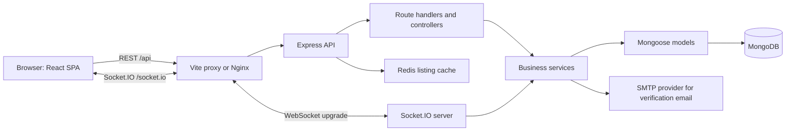

# PassItOn

PassItOn is a campus marketplace for secondhand goods. Students can list items, search for useful finds, reserve an item, coordinate a handoff with the seller, and review the completed transaction. It is built as a React single-page application backed by an Express API, MongoDB, Redis caching, and Socket.IO messaging.

This document explains the system from the browser to the database, how its main workflows operate, how to run it, and how to describe the design in an interview.

## 1. Project at a glance

### The problem

Students often need affordable textbooks, electronics, furniture, and other campus essentials. At the same time, other students have usable items they no longer need. PassItOn gives them one campus-focused place to discover those items and arrange a handoff.

### Main user journeys

1. A student registers and verifies their email address.
2. A seller creates a listing with a title, description, price, category, condition, and optional photos.
3. A buyer searches or filters listings, opens a listing, then reserves it or contacts the seller.
4. Buyer and seller coordinate using the conversation attached to that listing.
5. The seller accepts or rejects a reservation. The buyer can cancel a pending request.
6. After an accepted handoff, either participant can review the other. Users can also report listings or users.

## 2. Architecture overview



### Responsibilities by layer

| Layer | Location | Responsibility |
| --- | --- | --- |
| User interface | `frontend/src/main.jsx`, `frontend/src/styles.css` | Renders the marketplace, forms, dialogs, account tools, and chat panel. |
| Frontend build and local proxy | `frontend/vite.config.js` | Runs the Vite development server and proxies API and Socket.IO requests locally. |
| Production web server | `frontend/nginx.conf` | Serves the built static app and forwards API and WebSocket traffic to the backend container. |
| HTTP application | `backend/src/app.js` | Configures Express JSON parsing, the health route, and API route groups. |
| Routes and middleware | `backend/src/routes/`, `backend/src/middleware/` | Maps HTTP methods and paths to handlers, then applies authentication, verification, and rate limits. |
| Controllers | `backend/src/controllers/` | Validates request input, calls services, and converts results into HTTP responses. |
| Services | `backend/src/services/` | Implements marketplace rules and coordinates database operations. |
| Persistence | `backend/src/models/` | Defines MongoDB document shapes, validation rules, references, and indexes using Mongoose. |
| Realtime transport | `backend/src/realtime/socket.js` | Authenticates socket connections, authorizes conversation actions, and emits message and chat notifications. |
| Cache | `backend/src/config/redis-cache.js` | Caches public listing feeds and invalidates the cached feed keys after relevant changes. |
| Runtime configuration | `backend/src/config/`, `.env` | Loads database, token, email, URL, and runtime settings from environment variables. |

The browser calls the API for normal reads and writes. Socket.IO is used for live message delivery and notifications. Both message transports use the same message service, so HTTP and socket messages share persistence and participant checks.

## 3. Request lifecycle

### A public listing search

1. The React interface creates a query string with the search phrase, category, hostel, and page size.
2. The shared frontend `api()` helper sends a request to `GET /api/listings`.
3. In local development, Vite proxies `/api` to `http://localhost:5000`. In Docker, Nginx proxies it to the `backend` service.
4. `listListingsHandler` validates numeric filters and reads the query parameters.
5. The Redis cache is checked using the request URL as part of the key. If it misses, `listing.service.js` builds a MongoDB filter, sorts the results, applies pagination, and populates seller summary fields.
6. The response includes listing data and pagination metadata. The React view renders the returned cards.

Search matches listing title, description, and category. Category and hostel filters can also be sent separately. The Graduating Soon feed is a distinct query based on listing graduation dates.

### An authenticated write

1. The frontend API helper reads the JWT from browser local storage and sends it as `Authorization: Bearer <token>`.
2. `authenticate` verifies the signature and expiry using `JWT_SECRET`, then attaches the subject, role, and email verification state to the request.
3. Protected marketplace routes also use `requireVerifiedEmail`.
4. The controller validates required fields and identifiers, calls the business service, and maps expected service errors to HTTP statuses.
5. Mongoose validates and persists the resulting document. Listing and reservation changes invalidate the listing cache when needed.

## 4. Frontend design

The frontend is a Vite-built React single-page application. It does not currently use a client-side routing library. The main page and modal components are composed in `frontend/src/main.jsx`; React state determines which account, listing, review, reports, or reservation dialog is open.

The `api()` helper centralizes JSON requests, attaches the session token, parses API errors, and clears an expired session after a 401 response. The application uses local storage for the JWT, the signed-in user summary, and notification display state. The chat panel maintains the live Socket.IO connection for the current session.

The frontend currently includes:

- Account registration, login, verification-link handling, and verification-email resend.
- Listing search, category and hostel filters, details, photo previews, creation, editing, deletion, and a Mark as sold action.
- Potential duplicate warnings before publication.
- Buyer reservation history and cancellation, plus seller request accept/reject actions.
- Direct seller conversations, realtime messages, unread indicators, and notifications.
- Profile editing, including a profile photo.
- Review creation, display, and deletion by the review author.
- Listing/user reports and report history for the reporting user.

## 5. Backend design

### Express and controllers

`backend/src/server.js` creates one HTTP server, attaches Socket.IO to that server, connects to MongoDB, optionally seeds a demo account, and then listens on `PORT`. Express is configured in `app.js`; the JSON request body limit is 8 MB to allow small Base64 image payloads.

Controllers keep transport concerns at the edge of the application: request shape, identifier validation, response status, and response body. Services hold operations that need domain checks or more than one model interaction. For example, the reservation service checks listing availability, prevents self-reservation, changes listing status, creates the reservation, and invalidates the feed cache.

### MongoDB document model

MongoDB stores the marketplace entities as documents. Mongoose references connect related documents; services populate the small set of related fields needed by API responses.

| Model | Main fields and relationships |
| --- | --- |
| `User` | Name, normalized email, bcrypt password hash, college, hostel, graduation year, profile image, role, verification state, and hashed verification token with expiry. |
| `Listing` | Title, description, price, category, condition, image data URLs, seller reference, pickup hostel, graduation date, and status (`active`, `reserved`, `sold`, or `expired`). |
| `Reservation` | Listing reference, buyer reference, and status (`pending`, `accepted`, `rejected`, or `cancelled`). |
| `Conversation` | Listing, buyer, and seller references, last-message summary, read timestamps, and participant-specific unread counts computed from messages. |
| `Message` | Conversation and sender references, body, timestamps, and users who have read the message. |
| `Review` | Reviewer and reviewee references, reservation reference, rating, and optional comment. Average rating is computed from reviews rather than stored on the user. |
| `Report` | Reporter, target type and reference, reason, description, and moderation status. |

Indexes support common lookups and enforce important uniqueness rules. For example, a partial unique index prevents duplicate pending reservations for the same buyer/listing, a unique conversation index prevents duplicate buyer/seller threads for one listing, and a unique reviewer/reservation index prevents duplicate reviews for the same handoff.

### Authentication and email verification

Passwords are hashed with bcrypt in a Mongoose `pre("save")` hook. Login compares the submitted password with the hash and returns a signed JWT. The JWT contains the user ID, role, and email-verification state; protected endpoints verify it on every request. Tokens use the configured expiration, which defaults to seven days.

Registration creates an unverified user and a cryptographically random verification token. The database stores only the token’s SHA-256 hash and an expiry timestamp. The raw token is placed in the email verification URL and is not stored in the user document. Verification hashes the submitted token, finds the matching account, checks expiry, and clears the token after use. Login and marketplace routes require a verified account.

Email is sent through Nodemailer and the SMTP settings in `.env`. If `SMTP_HOST` is blank, the service uses a development fallback and writes the verification link to the backend log instead of delivering email. The resend route has a configurable cooldown (60 seconds by default); its in-memory limiter is keyed by client IP and normalized email.

The optional demo seeder creates a verified local account when `SEED_DEMO_USER=true`. It does not overwrite an existing account with that email.

### Listings, search, duplicates, and cache

Listing reads support text search, category, condition, hostel, status, price range, sort order, page, and page size. Search currently checks title, description, and category. Public listing reads default to active and reserved listings; sellers can request an explicit status when managing their own listings.

Duplicate detection is a warning system, not an automatic deletion system. It compares a new or edited listing with up to 25 active/reserved listings from the same seller and category. The score combines title similarity (55%), description similarity (25%), category (10%), and price similarity (10%). Text similarity uses token Jaccard similarity after normalization and stop-word removal. Scores at or above 65 are returned as possible matches. The seller can review the candidates and explicitly confirm publication.

Redis caches public listing responses for 45 seconds. An index key tracks the feed cache keys so the application can invalidate them after listing creation, editing, deletion, reservation, cancellation, or seller decision. If Redis is unavailable, cache reads and writes are ignored and the service loads results from MongoDB. Cache failure therefore reduces performance but does not make the listing endpoint unavailable.

### Reservations and seller decisions

Creating a reservation atomically changes an active listing to reserved, then creates a pending reservation for the buyer. The service prevents reserving one’s own listing and reports unavailable or already-reserved listings. Sellers can accept or reject pending requests. Rejecting returns the listing to active; accepting keeps the listing reserved until the seller marks it sold. Buyers can cancel a pending reservation, which returns the listing to active.

### Conversations and realtime chat

Conversations are scoped to a listing and its buyer/seller pair. The backend creates or reuses a conversation and notifies the seller when a new one is created. Both users must have a valid JWT and verified email to use the conversation API or connect to Socket.IO.

Socket.IO authenticates the JWT during the handshake. Each socket joins a private user room for notifications. Before joining a conversation room, the server checks that the user is one of that conversation’s participants. Before sending a message, it checks the conversation and participant again, validates the body, and calls the shared message service. A successful message is persisted, updates the conversation’s last-message summary, and is emitted to participants and the recipient’s private notification room.

The browser uses REST to load the conversation list and message history. It uses Socket.IO for sends and immediate events. Nginx forwards WebSocket upgrade requests at `/socket.io/` to the backend container.

### Reviews and reports

Reviews are allowed only for accepted reservations and only for the buyer or seller involved in that transaction. The unique index prevents duplicate reviews by the same reviewer for that handoff. Users can read another user’s reviews and delete a review they authored.

Users can report a listing or another user with a reason and optional description. They can view their own reports and their current status. The API currently provides report submission and personal report history; it does not include a staff moderation dashboard or moderation-management endpoints.

### Image storage

The browser converts selected listing and profile photos into Base64 data URLs. Those strings are sent in JSON and saved directly in MongoDB (`Listing.images` and `User.profileImage`). Listing creation accepts up to five frontend-selected images, each limited to 1 MB by the UI; the model allows up to ten strings. Profile photos are limited to 1 MB in the UI. This keeps the current deployment simple, but it increases document size and database/network usage. A production-scale version would typically store binary assets in object storage and keep only URLs and metadata in MongoDB.

## 6. API surface

Protected routes require `Authorization: Bearer <JWT>`. Routes that change marketplace data also require a verified email.

| Area | Route | Purpose |
| --- | --- | --- |
| Auth | `POST /api/auth/register` | Create an unverified account and send or preview a verification link. |
| Auth | `POST /api/auth/login` | Authenticate and return a JWT after email verification. |
| Auth | `GET /api/auth/verify-email/:token` | Verify an account using a one-time token. |
| Auth | `POST /api/auth/resend-verification` | Replace and resend the verification token; rate limited. |
| Listings | `GET /api/listings` | Search/filter/paginate public listings. |
| Listings | `GET /api/listings/graduating-soon` | List active items with graduation dates inside the configured window. |
| Listings | `GET /api/listings/:id` | Fetch one listing with seller summary. |
| Listings | `POST /api/listings` | Create a listing, with duplicate warning checks. |
| Listings | `POST /api/listings/duplicate-check` | Check a proposed listing for possible duplicates. |
| Listings | `PATCH /api/listings/:id` | Update an owned listing, including status. |
| Listings | `DELETE /api/listings/:id` | Delete an owned listing. |
| Reservations | `POST /api/reservations` | Reserve an active listing. |
| Reservations | `GET /api/reservations?mine=true` | List the current buyer’s reservations. |
| Reservations | `GET /api/reservations?received=true` | List reservations for the current seller. |
| Reservations | `PATCH /api/reservations/:id/accept` | Accept a pending request. |
| Reservations | `PATCH /api/reservations/:id/reject` | Reject a pending request. |
| Reservations | `DELETE /api/reservations/:id` | Cancel the current buyer’s pending request. |
| Conversations | `POST /api/conversations` | Create or reuse a listing conversation. |
| Conversations | `GET /api/conversations` | List conversations for the current user. |
| Conversations | `GET /api/conversations/:id` | Fetch one conversation for a participant. |
| Messages | `GET /api/conversations/:id/messages` | Load history and mark messages read. |
| Messages | `POST /api/conversations/:id/messages` | Send a message over HTTP. |
| Users | `GET /api/users/me` | Read the signed-in user’s profile. |
| Users | `PATCH /api/users/me` | Update allowed profile fields. |
| Reviews | `POST /api/reviews` | Review an accepted transaction. |
| Reviews | `GET /api/reviews/user/:userId` | Read reviews and aggregate rating for a user. |
| Reviews | `GET /api/reviews/mine` | List reservations the current user has reviewed. |
| Reviews | `DELETE /api/reviews/:id` | Delete a review authored by the current user. |
| Reports | `POST /api/reports` | Report a listing or user. |
| Reports | `GET /api/reports/me` | List reports submitted by the current user. |

Socket.IO client events are `conversation:join`, `conversation:leave`, and `message:send`. Server events include `message:new` and `notification:new`.

## 7. Running the application

### Recommended: Docker Compose

Requirements: Docker Desktop and a root `.env` file. Start from the repository root:

```powershell
Copy-Item .env.example .env  # only if .env does not already exist
```

Set a strong `JWT_SECRET` and configure `MONGO_URI`. For the MongoDB container in Compose, use:

```dotenv
MONGO_URI=mongodb://mongo:27017/passiton
```

The sample root `.env.example` is a template and may need the required `MONGO_URI` added. Then start the services:

```powershell
docker compose up --build -d
```

Open `http://localhost`. The web service serves Nginx on port 80; the backend is exposed on `http://localhost:5000` for local API work. Compose starts MongoDB and Redis and waits for their health checks before starting the backend.

For the verified demo account, set these values in the root `.env` before starting or restarting the backend:

```dotenv
SEED_DEMO_USER=true
DEMO_USER_EMAIL=demo@lpu.in
DEMO_USER_PASSWORD=DemoPass123!
```

The seeder creates the account only if it does not already exist. After changing application code, rebuild the affected images:

```powershell
docker compose up --build -d backend web
```

To stop the containers, use `docker compose down`. Avoid `docker compose down -v` unless you intentionally want to remove the MongoDB data volume.

### Local development without Docker

Run MongoDB and Redis separately, then create `backend/.env` from `backend/.env.example`. Set `MONGO_URI`, `JWT_SECRET`, and other needed values. In one PowerShell terminal:

```powershell
cd backend
npm install
npm run dev
```

In another terminal:

```powershell
cd frontend
npm install
npm run dev
```

Open `http://localhost:5173`. Vite proxies `/api` and `/socket.io` to the backend on port 5000. For a remote API, set `VITE_API_URL` in `frontend/.env`.

## 8. Configuration reference

| Variable | Purpose | Typical default |
| --- | --- | --- |
| `PORT` | Backend HTTP port. | `5000` |
| `MONGO_URI` | MongoDB connection string. | Required. |
| `REDIS_URL` | Redis connection string. | `redis://localhost:6379` locally; Compose uses `redis://redis:6379`. |
| `JWT_SECRET` | JWT signing and verification secret. | Required; use a strong unique value. |
| `JWT_EXPIRES_IN` | JWT lifetime. | `7d` |
| `GRADUATING_SOON_WINDOW_DAYS` | Look-ahead window for the Graduating Soon feed. | `90` |
| `APP_BASE_URL` | Frontend base URL placed in verification links. | `http://localhost:5173` in backend config; Docker sets `http://localhost`. |
| `EMAIL_VERIFICATION_TOKEN_TTL_MINUTES` | Verification-token lifetime. | `15` |
| `RESEND_VERIFICATION_COOLDOWN_SECONDS` | Resend cooldown window. | `60` |
| `SMTP_HOST`, `SMTP_PORT`, `SMTP_SECURE` | SMTP relay connection. | Empty host, port `587`, non-implicit TLS. |
| `SMTP_USER`, `SMTP_PASS` | SMTP credentials. | Empty unless configured. |
| `EMAIL_FROM` | Verified sender address and display name. | Local placeholder sender. |
| `SEED_DEMO_USER` | Whether startup creates the demo user when missing. | `false` |

Environment files contain secrets and are ignored by Git. Commit the example templates, never local credentials.

## 9. Testing

The backend test command is:

```powershell
cd backend
npm test
```

`test/run-tests.mjs` discovers the `*.test.js` files and runs them using Node’s test runner and module mocking. Tests do not require a running MongoDB service. Existing coverage focuses on authentication middleware, listing service ownership/CRUD behavior, and reservation rules. The frontend production build can be checked with:

```powershell
cd frontend
npm run build
```

## 10. Design choices and current limitations

- **MongoDB document storage:** The data maps naturally to user-created listings and transactional records. References and indexes enforce key relationships and uniqueness rules.
- **Services shared by HTTP and sockets:** Message persistence and authorization are not duplicated between transports.
- **Redis as an optional cache:** Listing feed reads can be served from MongoDB if Redis is unavailable.
- **Duplicate detection as a warning:** Similarity is explainable and seller-controlled; it does not automatically hide or delete user content.
- **Base64 photo storage:** Simple for a small local deployment, but not suitable for large or high-volume image workloads. Object storage is the natural next step.
- **Single React source file:** The UI is compact to run, but `main.jsx` has grown large. A next maintainability step would be to split features into pages, components, hooks, and an API module.
- **Local-storage session token:** Straightforward for this demo. A production security review should consider XSS exposure and whether secure, HttpOnly cookies are a better fit.
- **In-memory resend limiter:** The limiter works within one backend process. A multi-instance production service should store rate-limit state in Redis or another shared system.
- **Reporting workflow:** Users can submit and view their own reports. A staff moderation interface and administrative actions are not implemented.
- **Email domain policy:** Registration currently normalizes email and validates its general syntax. Although Compose includes an `ALLOWED_EMAIL_DOMAINS` value, the current registration utility does not enforce that setting; add explicit domain validation if campus-only registration is a requirement.
- **Deployment security:** The Compose file is a local/demo deployment. Real deployment should use HTTPS, a strong secret, a restricted Socket.IO origin, authenticated database access, an authenticated email sender/domain, monitoring, and backups.

## 11. Interview explanation

### A 30-second summary

> PassItOn is a campus resale marketplace built as a React SPA with an Express and Node.js API. MongoDB stores users, listings, reservations, conversations, messages, reviews, and reports. The backend is layered into routes, middleware, controllers, and services. JWTs protect user actions, Redis caches public listing feeds, and Socket.IO provides authenticated realtime chat. Docker Compose runs the web server, API, database, and cache together.

### A deeper walkthrough

> A user searches from the React page. The frontend sends query parameters through a shared API helper. In Docker, Nginx serves the Vite build and reverse-proxies API requests to Express. The listings controller validates the query and checks Redis before the listing service queries MongoDB. Mongoose applies the schema and indexes, and the controller returns a paginated JSON response.
>
> For a write, the frontend sends its JWT as a bearer token. Authentication middleware verifies it and attaches the user ID. Verified-email middleware protects marketplace actions. The controller validates the payload and delegates business rules to a service. For example, reservation creation changes an available listing to reserved and creates a pending reservation. The service invalidates listing-cache entries so later searches reflect the new state.
>
> Chat uses the same identity model. Socket.IO verifies the JWT at connection time, joins a private user room, and checks conversation membership before joining a conversation room or sending a message. The message service persists the message and updates the conversation summary. Socket.IO then emits the message to the conversation and a notification to the other participant.

### Tradeoffs to discuss

1. Why MongoDB/Mongoose fits the current domain and what would change if relational reporting became more important.
2. Why listing results are cached and how invalidation keeps the cache fresh.
3. Why duplicate detection produces candidates for human review instead of deleting listings automatically.
4. How the current Base64 image approach simplifies deployment and why object storage would scale better.
5. How the system would evolve for multiple backend replicas: shared Socket.IO adapter, shared rate limits, observability, and stronger deployment security.

## 12. Repository map

```text
frontend/
  src/main.jsx                 React application and feature dialogs
  src/styles.css               Application styles
  vite.config.js               Development API and Socket.IO proxies
  nginx.conf                   Production static serving and reverse proxy
  Dockerfile                   Vite build stage and Nginx runtime image
backend/
  src/app.js                   Express app and route mounting
  src/server.js                HTTP server, DB startup, Socket.IO, demo seed
  src/config/                  Environment, database, and Redis cache helpers
  src/controllers/             HTTP request handlers
  src/middleware/              JWT, verified-email, and rate-limit middleware
  src/models/                  Mongoose schemas and indexes
  src/realtime/socket.js        Socket.IO authentication and events
  src/routes/                  API route definitions
  src/scripts/seedDemoUser.js  Optional verified demo account
  src/services/                Marketplace and email business logic
  src/utils/                   Token and email helpers
  test/                        Isolated backend tests
docker-compose.yml             Local multi-container stack
```
